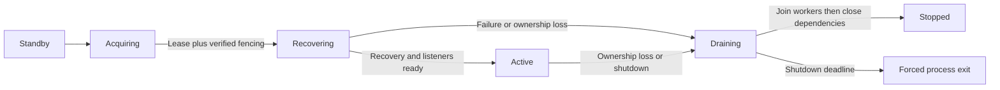

# ADR 0001: Own the homeserver as one application lifetime

Status: Proposed for maintainer review, lifecycle foundation implemented by #347.
Related: #345, #346, #347.

## Context

The monolith contains local sync positions, notification waiters, room workers, federation queues, and caches.
Sharing PostgreSQL and JetStream does not make these objects safe to replicate actively.
Component constructors and route registration also perform migrations, subscribe to streams, and launch jobs.

## Decision

Use one monolith activation per operating-system process.
Constructing the lifecycle is inert; explicitly running it authorizes application initialization.
The caller must establish ownership and fencing before invoking activation.
Cancellation is local shutdown machinery, not proof of fencing.
Standalone mode authorizes activation immediately and continues to require no Kubernetes access.

| State | Permitted behavior | Transition |
| --- | --- | --- |
| Standby | Process logging, profiling, health, metrics, and future election only | Election attempt enters acquiring |
| Acquiring | Election and external fencing verification only | Confirmed safe ownership enters recovering |
| Recovering | Initialize databases/migrations, NATS, caches, workers, and public handlers | Successful recovery and listener binding enters active |
| Active | Serve Matrix traffic and run application jobs | Cancellation or failure enters draining |
| Draining | Reject new local work, cancel workers and requests, join them, then close dependencies | Completion enters stopped; deadline forces process exit |
| Stopped | No application work and no reacquisition in this process | Supervisor starts a fresh process |

The lifecycle implementation models standby, recovering, active, draining, and stopped.
Acquiring belongs to the future election/fencing controller, outside application initialization.
Lease acquisition alone never publishes readiness.
Full HA recovery readiness and Kubernetes probes remain work for #350 and #351.

Register workers before launching them and make their contexts descendants of the activation context.
Work that outlives an HTTP request, such as auto-purge and push delivery, retains the application lifetime rather than using a detached root context.
Join startup, requests, and workers before releasing database pools, NATS connections, indexes, and caches.
Run dependency cleanup in reverse registration order.
Cancellation during partial startup uses the same join and cleanup path.
If an existing constructor blocks, panics, or calls a fatal logger, the activation must never be reused; the process is the final containment boundary.

Use a 30-second total shutdown budget initially.
HTTP receives a five-second graceful shutdown budget within that limit, followed by connection closure.
A worker or constructor that does not stop before the total deadline requires a nonzero process exit.
Never return to standby after that deadline.
This is not a claim that local deadlines protect against a suspended process; ADR 0003 supplies that protection.

## Consequences

This avoids rebuilding global registries, hooks, and singleton caches after demotion.
It costs a process restart and state recovery on every failover.
Standbys do not maintain warm application caches, because initialization itself currently has side effects.
The lifecycle is testable without an election backend and can be reviewed before HA is enabled.

## Durability, recovery, and upgrades

The initial release target is successful client and federation requests within 120 seconds of a crash in the reference deployment, including election, fencing, recovery, and routing.
Record each stage and verify every release qualification scenario against the target in #352.
The reference workload is 100 local users, 1,000 joined rooms, and five accepted messages per second with a representative durable queue backlog.
Larger deployments must publish measured recovery times; a full index rebuild may exceed this target.
An unavailable control plane, fencer, or storage dependency intentionally suspends the recovery-time objective rather than permitting unsafe takeover.

Target zero loss of successfully acknowledged persistent Matrix writes for one application-node failure with PostgreSQL synchronous replication and JetStream quorum-backed persistent streams.
This target is conditional on #350 auditing database/stream acknowledgement boundaries and #352 verifying them.
Ephemeral typing and presence are not durable-message guarantees.
External delivery is at least once where retryable, never exactly once.

Only identical binary versions and configuration are supported for initial automatic takeover.
Run migrations only after safe ownership, before readiness, and prohibit a standby with an incompatible schema or binary from promoting.
For upgrades, disable automatic promotion, stop and fence the old activation, take verified backups, migrate with one new activation, then admit matching candidates.
Rollback requiring an older schema uses a tested restore procedure; do not start an old binary against a migrated database.
Rollback to standalone first disables election candidates and proves they are stopped/fenced, then starts exactly one instance with the same identity and storage.
